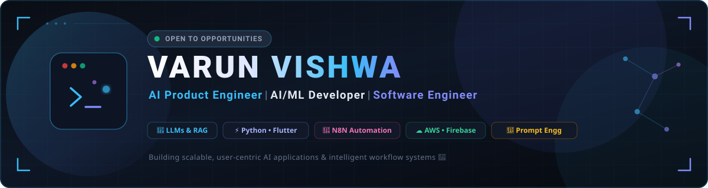

<div align="center">

  <!-- Header Banner -->
  <a href="https://linkedin.com/in/varunvishwa">
    
  </a>

  <br/><br/>

  <!-- Dynamic Typing Header / Tagline -->
  <a href="https://readme-typing-svg.demolab.com?font=Fira+Code&weight=600&size=20&duration=3000&pause=1000&color=38BDF8&center=true&vCenter=true&multiline=false&width=750&height=40&lines=AI+Product+Engineer+%7C+AI%2FML+Developer;Building+Autonomous+AI+Systems+%26+LLM+Pipelines;Crafting+End-to-End+Scalable+Products+%F0%9F%9A%80;Flutter+%E2%80%A2+Python+%E2%80%A2+TensorFlow+Lite+%E2%80%A2+N8N">
    
  </a>

</div>

<br/>

<!-- ========================================================================= -->
<!-- SECTION: ABOUT ME                                                         -->
<!-- ========================================================================= -->

## 📌 About Me

<table>
  <tr>
    <td width="62%" valign="top">

```javascript
const varun = {
  name: "Varun Vishwa",
  role: "AI Product Engineer | AI/ML Developer | Software Engineer",
  location: "India 🇮🇳",
  education: {
    degree: "B.E. Computer Science and Engineering",
    institution: "Anna University",
    timeline: "2023 – 2027"
  },
  
  building: [
    "AI-powered healthcare platforms (VMed)",
    "Intelligent enterprise workflow automations (N8N)",
    "Offline edge AI disease detection systems (VedCrop)"
  ],
  
  learning: [
    "Agentic AI Architectures & Multi-Agent Systems",
    "Advanced Retrieval-Augmented Generation (RAG)",
    "Production LLMOps, Fine-Tuning & System Design"
  ],
  
  tech: {
    languages: ["Python", "Java", "Dart"],
    ai_ml: ["LLMs", "RAG", "Prompt Engineering", "TensorFlow Lite"],
    cloud_backend: ["Firebase", "AWS", "Nginx", "RESTful APIs"],
    tools: ["N8N Automation", "Git", "VS Code", "Figma", "Canva"]
  }
};
```

> *"The best way to predict the future is to invent it — solving real-world challenges through intelligent, scalable, and user-centric engineering."*

   </td>
   <td width="38%" align="center" valign="middle">
      
   </td>
  </tr>
</table>

<br/>

<!-- ========================================================================= -->
<!-- SECTION: CONNECT WITH ME                                                  -->
<!-- ========================================================================= -->

## 📬 Connect With Me

<div align="center">
  <a href="https://linkedin.com/in/varunvishwa" target="_blank">
    
  </a>
  &nbsp;
  <a href="mailto:varunvishwa169@gmail.com" target="_blank">
    
  </a>
  &nbsp;
  <a href="https://github.com/varunvishwa" target="_blank">
    
  </a>
  &nbsp;
  <a href="https://x.com/" target="_blank">
    
  </a>
  &nbsp;
  <a href="tel:+919074485206" target="_blank">
    
  </a>
</div>

<br/>

<!-- ========================================================================= -->
<!-- SECTION: TECH STACK                                                       -->
<!-- ========================================================================= -->

## 🛠️ Tech Stack

<div align="center">

  <!-- Skill Icons Strip -->
  <a href="#">
    
  </a>

  <br/><br/>

  <!-- Categorized Badges -->
  <div>
    <!-- Programming Languages -->
    
    
    
    
    &nbsp;|&nbsp;
    <!-- AI & ML -->
    
    
    
    
    <br/><br/>
    <!-- Cloud & Backend -->
    
    
    
    
    &nbsp;|&nbsp;
    <!-- Automation & Developer Tools -->
    
    
    
    
    
    
  </div>

</div>

<br/>

<!-- ========================================================================= -->
<!-- SECTION: FEATURED PROJECTS                                                -->
<!-- ========================================================================= -->

## 🚀 Featured Projects

<table>
  <tr>
    <td width="50%" valign="top">
      <h3>🏥 VMed – AI Healthcare Platform</h3>
      <p>
        An AI-powered digital healthcare ecosystem designed for smart patient management, automated appointment scheduling, digital medical record tracking, and AI-assisted healthcare diagnostics.
      </p>
      <p>
        <b>Tech Stack:</b> <code>Flutter</code> • <code>Python</code> • <code>Firebase</code> • <code>AI / ML</code>
      </p>
    </td>
    <td width="50%" valign="top">
      <h3>🔄 AI Workflow Automation using N8N</h3>
      <p>
        Autonomous multi-service automation pipelines enabling dynamic AI content generation, real-time RSS feed monitoring, and webhook-triggered event handling to optimize business workflow efficiency.
      </p>
      <p>
        <b>Tech Stack:</b> <code>N8N</code> • <code>LLMs</code> • <code>Webhooks</code> • <code>REST APIs</code>
      </p>
    </td>
  </tr>
  <tr>
    <td colspan="2" valign="top">
      <h3>🌱 VedCrop – AI Crop Disease Detection</h3>
      <p>
        An edge-AI mobile application built to empower farmers with immediate on-device leaf disease diagnosis from images, intelligent treatment and remedy recommendations, and offline operation capabilities.
      </p>
      <p>
        <b>Tech Stack:</b> <code>Flutter</code> • <code>TensorFlow Lite</code> • <code>Python</code> • <code>Firebase</code> • <code>Computer Vision</code>
      </p>
    </td>
  </tr>
</table>

<br/>

<!-- ========================================================================= -->
<!-- SECTION: EXPERIENCE & LEADERSHIP                                          -->
<!-- ========================================================================= -->

## 💼 Leadership & Experience

- 🏛️ **Student Secretary** — *Department of Computer Science & Engineering (Anna University)*
- 💡 **Developer Hub Lead** — *Academic Leadership, Developer Mentorship & Community Building*
- 🎨 **Graphic Designer & Script Writer** — *College Media Team*

<br/>

<!-- ========================================================================= -->
<!-- SECTION: GITHUB ANALYTICS                                                 -->
<!-- ========================================================================= -->

## 📊 GitHub Analytics

<div align="center">

  <!-- GitHub Activity Graph -->
  <a href="https://github.com/varunvishwa">
    
  </a>

  <br/><br/>

  <!-- Stats & Top Languages Side by Side -->
  <table border="0" width="100%">
    <tr align="center">
      <td width="50%" align="center">
        <a href="https://github.com/varunvishwa">
          
        </a>
      </td>
      <td width="50%" align="center">
        <a href="https://github.com/varunvishwa">
          
        </a>
      </td>
    </tr>
  </table>

  <br/>

  <!-- GitHub Streak Stats -->
  <a href="https://github.com/varunvishwa">
    
  </a>

</div>

<br/>

<!-- ========================================================================= -->
<!-- SECTION: GITHUB TROPHIES                                                  -->
<!-- ========================================================================= -->

## 🏆 GitHub Trophies

<div align="center">
  <a href="https://github.com/ryo-ma/github-profile-trophy">
    
  </a>
</div>

<br/>

<!-- ========================================================================= -->
<!-- FOOTER                                                                    -->
<!-- ========================================================================= -->

<div align="center">
  
  <p align="center">
    <i>Designed with ❤️ for Varun Vishwa's GitHub Profile</i>
  </p>
</div>
