<a href="#connect">
  
</a>

  
  
  
  


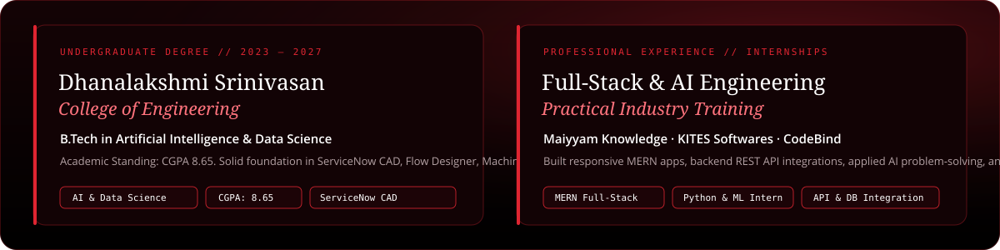


<!-- Project 1: StudyMate -->
<a href="#study-mate">
  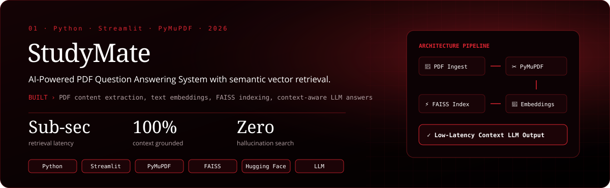
</a>

  
  
  

<!-- Project 2: AI Workflow Automation using n8n -->
<a href="#n8n-automation">
  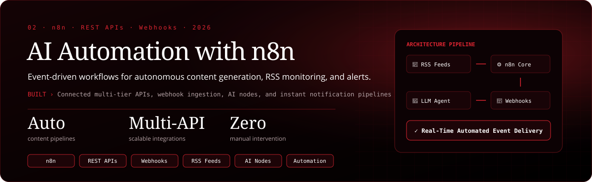
</a>

  
  
  

<!-- Project 3: VedCrop -->
<a href="#vedcrop">
  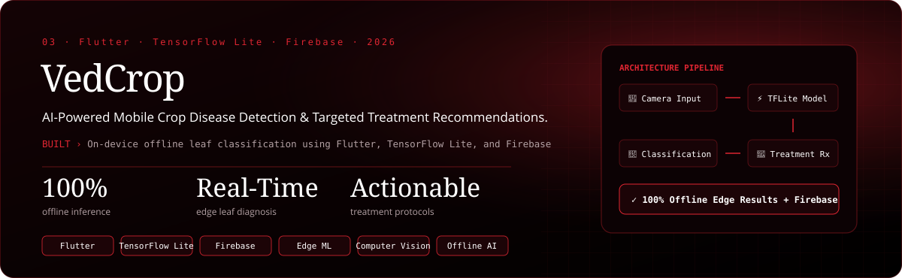
</a>

  
  
  



  
  

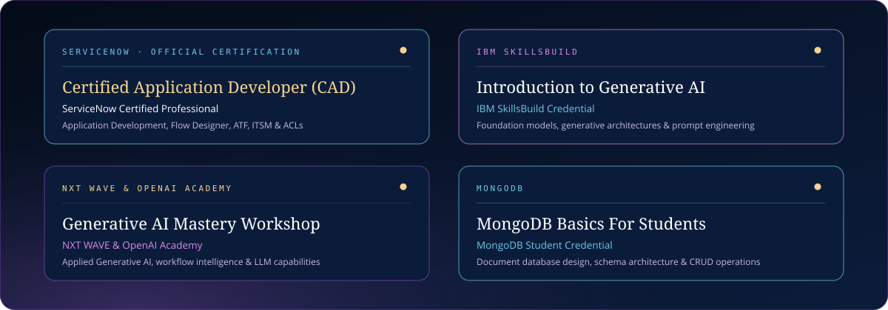


  
  
  
  

