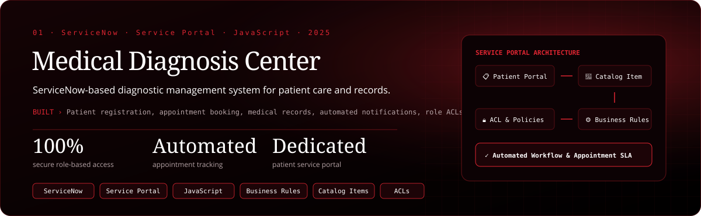
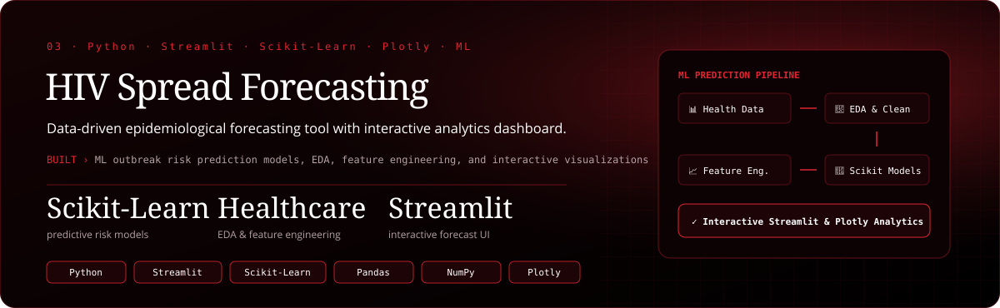

  
  
  
  
  

<!-- Project 1: Medical Diagnosis Center -->

  
  
  

<!-- Project 2: SmartIT -->

  
  
  

<!-- Project 3: Data-Driven HIV Spread Forecasting Tool -->

  
  
  

  
  

  
  
  
  

  
  
  
  

